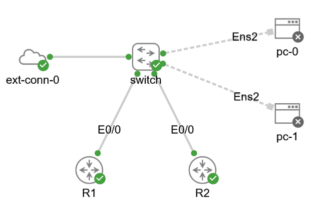

# 3. modul - Hálózatprogramozás és automatizáció

## Az Ansible jellemzői

- A hagyományos szerver-adminisztráció sok gép esetén lassú, unalmas és hibákra ad lehetőséget
- A konfigurációmenedzsment erre ad megoldást: _“a CM egy olyan folyamat, amely létrehozza és fenntartja a termék teljesítményének, funkcionális és fizikai jellemzőinek összhangját a követelményekkel, a tervezéssel és a működési információkkal az élettartama során”_
- Több népszerű eszköz is van a piacon: Puppet, Salt, Chef, cfengine
- Az __Ansible__ egy, a RedHat által támogatott, Python-ban íródott CM és automatizációs eszköz
- Maga az elnevezés egy sci-fi eszköz nevéből származik, amivel tetszőleges távolságra és azonnal lehet üzenetet küldeni
- Használható:
  - Utasítások lefuttatására egyszerre több szerveren
  - Konfiguráció menedzsmentre
  - Deploymentre, szolgáltatások telepítésére
  - Komplett virtuális környezetek felépítésére, tesztkörnyezetek gyors telepítésére
- Az egyes utasítások sikerességét sok esetben nem kell külön ellenőrizni, csak meghatározni a kívánt állapotot, a többit pedig az Ansible intézi -> __deklaratív__, vagyis a rendszer kívánt állapotát adjuk meg, és nem azt, hogy hogyan kell odáig eljutni (legalábbis legtöbb esetben)
- Emellett __idempotens__: akárhányszor fut le egy feladat, a végeredménye mindig ugyanaz
- Az Ansible __agentless__, azaz nem kell külön ügyfélprogram a menedzselt eszközökre
A menedzselt gépeken végrehajtandó feladatokat úgynevezett "playbook"-ba lehet megírni, ez a forgatókönyv YAML nyelven íródik

Az Ansible-ben kétféle eszköz típust különböztetünk meg:
- __vezérlő (controller)__: legtöbbször Control Node-nak, Ansible szervernek, Ansible Engine-nek nevezzük. Egyszerűbb környezetben ez egy sima laptop is lehet, ami 20-30 eszközt tud kezelni. Operációs rendszer tekintetében lehet bármilyen Linux, MacOS, vagy valamilyen BSD variáns, azonban a Windows vezérlőként nem támogatott;
- __kezelt eszközök__: Managed Nodes, vagyis menedzselt eszközök néven szoktak említeni. Az Ansible egy Agentless távmenedzsment eszköz, ami azt jelenti, hogy nem kell külön programot telepíteni a kezelt eszközökre. A kezelt eszközökkel szemben legtöbbször az SSH kapcsolat létesítés képessége és a Python Interpreter jelenléte a követelmény.

A menedzselt eszközök adatait egy adatbázisban, az inventory-ban tároljuk. Az inventory legtöbbször egy szövegfájl, amiben valamilyen szintaxissal megadjuk, hogy melyik IP címen lévő eszközöket szeretnénk kezelni. A fájl formátuma lehet INI, JSON vagy YAML. Eszközcsoportokat is kialakíthatunk.

Ezután meg kell határoznunk, hogy az eszköz az adott IP címen milyen belépési adatokkal érhető el. Ez megadható egyszerű szöveges változóként, de ez biztonsági szempontból nagyon nem ajánlott. Egy fokkal biztonságosabb, ha futtatásnál megadjuk az Ansible-nek, hogy menet közben kérjen jelszót, de ez hosszú távon elég kényelmetlen. A megoldás az Ansible Vault: ezzel titkosított változóként adjuk meg a belépési adatokat, amit csak a Vault jelszó megadása után old fel az Ansible Engine.

Az Ansible Python modulokkal kezeli az eszközöket. A vezérlő gépen paraméterezzük a modult vagy modulokat, és ezeket futtatjuk, az eredmény pedig megjelenik a menedzselt eszközökön. 

- szerverek esetén a paraméterezett modulokat felmásolja, lefuttatja, majd törli
- hálózati eszközök esetén a modulok a vezérlő gépen futnak le, és a modul által visszaadott parancsokat küldi el az adott eszköznek.

Az Ansible-nak két működési módja van: ad-hoc és playbook mód: 

- az __ad-hoc__ mód egyetlen modul parancssoros paraméterezését és a mintával megadott eszközöknek való elküldését jelenti. A minta egy rövid szöveg, amely meghatározza, hogy melyik gépekre fusson le a modul. Ilyen minta lehet például az “all” szó, amely az összes inventory-ban lévő eszközt jelenti
- a másik mód a __playbook__-ok, vagyis forgatókönyvek használata. Ezek a playbook-ok durva egyszerűsítéssel legjobban a szkriptekhez hasonlítanak. A playbook-ban play-ek szerepelnek, ezeken belül lehet feladat listát definiálni. A feladat (task) egy-egy modul paraméterezését jelenti. A feladat listán végig haladva, a vezérlő végrehajtja az előírt lépéseket, hogy az elvárt állapotba juttassa a menedzselt eszközt.

Súgó:
- elérhető modulok listázása:
  ```
  ansible-doc -l
  ```
- adott modul használata (pl. copy):
  ```
  ansible-doc copy
  ```

## Az Ansible telepítése (Debian)

1. Telepítés a vezérlő gépen:
```bash
apt update
apt install ansible sshpass
```
2. Telepítés a menedzselt gépeken:
```bash
apt update
apt install openssh-server sudo
```
3. Telepítés utáni konfigurálás

_A menedzselt gépeken:_
```bash
adduser --ingroup sudo ansible
service ssh restart
```
`/etc/sudoers` fájlba:
```
%sudo	ALL=(ALL:ALL) NOPASSWD:ALL
```
_A vezérlő gépen:_
```bash
mkdir /etc/ansible
```
`/etc/ansible/hosts` (inventory) kitöltése, példa: 
```
pc-1	ansible_host=192.168.0.11
pc-2	ansible_host=192.168.0.12
```
`/etc/hosts` kitöltése, példa:
```
192.168.0.11	pc-1
192.168.0.12	pc-2
adduser ansible
```
_A vezérlő gépen ansible userként:_
```
ssh-keygen
ssh-copy-id ansible@pc-1 (majd pc-2 stb.)
```

Ellenőrzés: `ansible -m ping all`

Cisco eszközök elérhetőségének tesztelése:
```
ansible -m ios_facts routers
```

## Inventory

Az inventory egy olyan adatbázis, amiben a menedzselt gépek eléréséhez szükséges adatok és egyéb beállítások találhatók. Globális helye a `/etc/ansible/hosts`, de definiálhatunk saját inventory-t is (ekkor az `ansible.cfg` fájt (lásd később) kell megfelelően kitölteni).

Formátuma lehet .INI vagy .YAML.

Az inventory-ban csoportosíthatjuk is az eszközöket. Létezik egy beépített "all" csoport, és definiálhatunk mi is több csoportot tartalmazó másik csoportot a `[szülőcsoport:children]` szekcióval. Példa:

```
[cisco]
rtr-1	ansible_host=192.168.122.21
rtr-2	ansible_host=192.168.122.22
[ubuntu]
ubuntu-fw1	ansible_host=192.168.122.11
ubuntu-fw2	ansible_host=192.168.122.12
```
Ekkor az összes eszközre az `all` kulcsszóval, a csoportokra pedig azok neveivel hivatkozhatunk.

Ha több változó is tartozik az adott hostokhoz, érdemes külön szekcióba tenni, pl.:
```
[cisco:vars]
ansible_user=ansible
ansible_ssh_pass=cisco123
ansible_network_os=ios
ansible_connection=network_cli
ansible_network_cli_ssh_type=paramiko
ansible_become=yes
```
Hosztok listázása: 
```
ansible --list-hosts all
```

Csak adott csoport listázása:  
```
ansible --list-hosts routers
```

## Az ansible.cfg fájl

A program fontosabb beállításait az `ansible.cfg` fájl tartalmazza. Helye lehet (sorrendben):

- ANSIBLE_CONFIG (környezeti változó)
- `ansible.cfg` (az aktuális könyvtárban)
- `~/.ansible.cfg` (a HOME könyvtárban)
- `/etc/ansible/ansible.cfg`

Az `ansible --version` parancs megmutatja, hogy aktuálisan hol keresi.
Egy teljes, de kommentezett verzió generálható az `ansible-config init --disabled` paranccsal.

Tartalmára példa:
```
[defaults]
inventory = ./hosts
host_key_checking = False     # ha változik az SSH kulcs, nem omlik össze
deprecation_warnings = False  # elavult dolgokról nem küld figyelmeztetést
[paramiko_connection]
look_for_keys = False	      # nem próbálja az SSH kulcsos bejelentkezést
```

## Labortopológia

Az alábbi labortopológiát használjuk a CML-ben:



## Egyszerű parancsok kiadása: ad-hoc mód

Ha csak az a feladat, hogy néhány információt kérjünk le, vagy egy egyszerű parancsot futtassunk le a menedzselt eszközökön, akkor az ad-hoc módot használjuk.
```
ansible -m modulnév -a "param1=érték1, param2=érték2..." all
```
1. példa: írassuk ki a HOME könyvtár tartalmát minden Linux hoston:
```
ansible -m command -a "ls ~" linux
```
2. példa: kérdezzük le a lemezek foglaltságát a gépeken:
```
ansible -m command -a "df -h" linux
```
3. példa: írassuk ki az interfészek adatait a routereken:
```
ansible -m ios_command -a "commands='show ip interface brief'" routers
```
Több paraméteres modul használatára példa:
```
ansible -b -m apt -a 'name=nginx state=present update_cache=true' linux
```

## A YAML leírónyelv

Amikor több lépésből álló feladatot kell elvégezni, az ad-hoc mód helyett playbook-okat futtatunk, amikhez a YAML leírónyelvet használjuk.

A YAML egy adatleíró nyelv (data serialization language), ami a programok és az emberek számára is lehetővé teszi adatok strukturált tárolását és feldolgozását, szöveges formában. Programnyelvek közti adatcseréhez nagyon jó, mert illeszkedik a fontosabb adatszerkezetekhez. Konfigurációs fájlokhoz, naplózáshoz is használatos.

Kétféle formátumot is támogat: a blokk stílus behúzásokkal tagolja az adatokat, de a JSON-féle folyam-stílus is használható, amiben határoló karaktereket használunk (pl. { és } ).  
__FONTOS__: folyam-stíluson belül nem használhatunk blokk stílust, illetve a behúzást csak szóközök alkothatják, tabulátor pl. nem! Az alapértelmezés két szóköz.

Három fő alkotóeleme: 
- sorozatok (listák), 
- leképezések (szótárak),  
- skalárok (számok, stringek, boolean stb. értékek)

### A YAML alkotóelemei: sorozatok

A __sorozatok__ több elemet tartalmazó adatszerkezetek, más nyelvekben listának, egydimenziós tömbnek is nevezik. 

Blokk stílus szintaktikája:
```yaml
- elem1
- elem2
- elem3
```
Folyam-stílus szintaktikája:
```yaml
[ elem1, elem2, elem3 ]
```
Ez utóbbi esetben a szóközök nem részei a listának!

A listák egymásba is ágyazhatók, akár vegyes írásmóddal is:
```yaml
- elem1
- elem2
- [ elem11, elem12 ]
```

### A YAML alkotóelemei: leképezések

A __leképezések__ (más néven szótár, hash) egy kulcs-érték párokat tartalmazó adattípus.

Blokk stílus szintaktikája:
```yaml
kulcs1: érték1
kulcs2: érték2
lista1: [ez, egy, lista]
```
Folyam-stílus szintaktikája:
```yaml
{ key1: value1, key2: value2, lista: [egy, kettő] }
```
Ha a kulcs több szóból áll, idézőjelek közé kell tenni.

Érték lehet bármilyen adattípus, ott nem kötelező az idézőjelek használata.

### A YAML alkotóelemei: skalárok

A _skalárok_ alapvető adattípusok, úgymint sztringek, számok, boolean értékek, dátumok.

Példák:
```yaml
lang: yaml
verzió: 1.2
egyszerű: true
semmi: null
idézet: "A barátom szerint: \"A YAML tök jó.\""
oktális: 0123   # mivel 0-val kezdődik
hexa: 0xFF
```
Kommentek is használhatók, mint a fenti példában is látható. Az egész sor komment lesz, ha #-tel keződik:
```yaml
# ez a sor egy komment
```
### A YAML alkotóelemei: dokumentumok

A YAML fájlokat .yml, vagy .yaml kiterjesztéssel mentjük el. Egy fájl több dokumentumból is állhat. 

A dokumentumokat három kötőjel nyitja meg, és három pont zárja le (ezt nem kötelező kitenni).

Példa:
```yaml
---
lang: yaml
verzió: 1.2
---
kulcs: érték
---
újkulcs: újérték
```

### Összetett adatszerkezetek leírása

Sokszor találkozunk olyan listákkal, amik elemei maguk is listák:
```yaml
- [alma, körte, barack]
- [sör, bor, pálinka]
```
Egymásba ágyazott leképezések is gyakoriak:
```
user:
  neve: Jani
  kora: 30
  cime: 
    város: Pécs
    utca: Kossuth L.
    szám: 12
  kutyája: { név: Cézár, szín: fekete }
```

Találkozhatunk sok egyéb összetétellel is, pl.: 
```yaml
net:
  - router: 
      ip: 10.0.0.1
      maszk: 255.255.255.0
  - switch:
      ip: 10.0.0.2
      maszk: 255.255.255.0
server:
  - Debian
  - Ubuntu
```

## Playbook-ok használata

A playbook-okat az `ansible-playbook file.yaml` paranccsal futtatjuk. Az ad-hoc parancsoktól eltérően itt nem látjuk azonnal a kimenetet; kérhetünk pl. debug módot az `ansible-playbook -vvv` opciójával, de jobb, ha a `register változónév` parancs beírásával egy változóban tároljuk a kimeneteket. Ezután a `debug` modullal tudjuk kiíratni ezeket. 

1. példa: Írassuk ki a "show version" parancs kimenetét minden routerről:
```yaml
---
- hosts: routers
  tasks:
    - ios_command:
        commands: show version
        register: verzio
    - debug:
        var: verzio
```

Érdemes az első éles futtatás előtt a `--check (-C)` opciót használni, hogy az alapvető hibák előjöjjenek. 
A play-eknek lehet értelmes nevet is adni a `--name` opcióval.

## A debug modul

A debug modul használható szöveges infók kiírására:
```yaml
- name: Print a simple statement
  debug:
    msg: "Hello World!" 
```
A _msg_ opcióba tehetünk változókat is:
```yaml
vars:
  greetings: Hello World!
tasks:
  - name: Print the value of a variable
    debug:
      msg: "The message is: {{ greetings }}"
```
Parancsok kimenetét a register modullal tesszük el egy változóba, amit kiíratunk a `debug`-gal:
```yaml
- name: Print system uptime
  shell: uptime -p
  register: system_uptime
- name: Print uptime of managed node
  debug:
    msg: "{{ system_uptime }}"
```
A kimenetből csak a stdout-ot a `system_uptime.stdout` segítségével írhatjuk ki.

## Változók

Tudunk saját változókat definiálni a vars: opcióval, pl.
```yaml
vars:
  ip: 10.0.0.1
...
commands: "ping {{ ip }}""
```

A változókat parancssorból felül tudjuk bírálni a `-e "változó=újérték"` opcióval.

Az Ansible az eszközről rengeteg információt kérdez le a kapcsolódáskor, ezeket "fact"-eknek nevezzük. 
(A szolgáltatást ki is lehet kapcsolni.) A setup nevű modullal tudjuk megnézni őket:
```
ansible -m setup pc1
```
Ezeket változóként felhasználhatjuk:
```yaml
- name: Prints Ansible facts
  debug:
    msg: The IP address of {{ ansible_fqdn }} is {{ ansible_default_ipv4.address }}
```
A változókat külön fájlokba is rakhatjuk, a `host_vars` és `group_vars` könyvtárakon belül az egyes gépek ill. csoportok neveivel megegyező .yaml fájlokba.

## Ciklusok

Ha egy task-ot többször is el kell végezni, akkor ciklust szervezünk.

A  legegyszerűbb esetben egy lista elemein megyünk végig:
```yaml
tasks:
  - name: Task description
    ansible_module:
      key: "{{ item }}"
    loop: [ member1, member2, member3]
```
Az "item" kulcsszó helyére helyettesítődnek be az egyes listaelemek. 

Példa:
```yaml
  - name: Update cache and install packages
    apt:
      name: "{{ item }}"
      update_cache: yes
    loop:
    - uftp
    - hping3
    - python3-scapy
```

## Feltételek

Egy task lefutását köthetjük [feltételek](https://docs.ansible.com/ansible/latest/playbook_guide/playbooks_conditionals.html)hez. Hozzuk létre a task-ot, majd adjunk hozzá egy `when` utasítást, ami egy tesztet alkalmaz. A `when` tulajdonképpen egy nyers Jinja2 kifejezés, dupla kapcsos zárójelek nélkül. A task vagy a playbook futtatásakor az Ansible kiértékeli a tesztet az összes gazdagépre vonatkozóan. Minden olyan gépen, amelyen a teszt sikeres (igaz értéket ad vissza), az Ansible futtatja a feladatot. A fact-ek nagyon jól használhatóak erre a célra, pl.:

```yaml
- name: Shut down Debian flavored systems
    ansible.builtin.command: /sbin/shutdown -t now
    when: ansible_facts['os_family'] == "Debian"
```

Ha több feltétel van, zárójelben csoportosíthatjuk őket (és a hosszú sorokat tördelhetjük a > segítségével):

```yaml
- name: Shut down CentOS 6 and Debian 7 systems
  ansible.builtin.command: /sbin/shutdown -t now
  when: >
    "(ansible_facts['distribution'] == 'CentOS' and ansible_facts['distribution_major_version'] == '6') or
    (ansible_facts['distribution'] == 'Debian' and ansible_facts['distribution_major_version'] == '7')"
```
Egy task futása függhet egy előző eredményétől. Ilyenkor a teendőink:

1. Regisztráljuk változóként a korábbi feladat eredményét.
2. Hozzunk létre egy feltételes tesztet a regisztrált változó alapján.

A regisztrált változó nevét a `register` kulcsszóval hozzuk létre. A regisztrált változó mindig tartalmazza az őt létrehozó task állapotát, valamint a task által generált bármely kimenetet. A regisztrált változó karakterlánc-tartalmát a `variable.stdout` segítségével érhetjük el. Példa:

```yaml
- name: Register a variable
        ansible.builtin.shell: cat /etc/motd
        register: motd_contents
- name: Use the variable in conditional statement
        ansible.builtin.shell: echo "motd contains the word hi"
        when: motd_contents.stdout.find('hi') != -1
```

1. példa:
```yaml
---
- name: Create /tmp/exists directory if user "cisco" exists
  hosts: all
  become: yes
  tasks:
    - name: Check if user "cisco" exists
      command: id cisco
      register: user_check
      ignore_errors: true		# akkor is folytatja, ha hiba van
    - name: Create /tmp/exists directory if user "cisco" exists
      file:
        path: /tmp/exists
        state: directory
      when: user_check.rc == 0	# rc: return code
```

2. példa: másoljunk ki egy adott fájlt minden Linux gép adott könyvtárába!

```yaml
---
- name: File-ok kimasolasa a gepekre
  hosts: linux
  become: yes
  become_user: root
  tasks:
    - name: file masolasa
      copy:
        src: /home/devasc/forras.txt
        dest: /home/devasc/GNS3/projects/ospf.gns3project
```

3. példa: módosítsuk a `/etc/sudoers` fájlt!
```yaml
---
- name: Konfig fajl modositasa
  hosts: all
  become: yes
  become_user: root
  tasks:
    - name: cmnd_alias beszurasa
      lineinfile:
        path: /etc/sudoers
        state: present
        regexp: '^# Cmnd '
        insertafter: '^# Cmnd '
        line: 'Cmnd_Alias NETPROGS = /usr/bin/ip, /usr/bin/nmtui'
    - name: cisco usernek alias adasa
      lineinfile:
        path: /etc/sudoers
        state: present
        line: 'cisco ALL=(ALL:ALL) NOPASSWD: NETPROGS'
```

4. példa: hozzunk létre több felhasználót!
```yaml
---
- name: Make users
  hosts: all
  become: yes
  gather_facts: no
  tasks:
    - name: Making users
      user:
        name: "{{ item }}"
        group: users
        password: '$5$riwJRFzKf9v$GkodDi8b2zzuRJS7eUQ8mbfnyda8HI31mkX0e1lEZrD'
        shell: /bin/bash
        comment: User "{{ item }}"
      loop:
        - tercsi
        - fercsi
        - kata
        - klara
```

## Ansible használata Cisco eszközökön

A hosts fájlt ki kell egészítenünk az eszközök adataival:

```
[routers]
r1	ansible_host=192.168.122.201
r2	ansible_host=192.168.122.202

[routers:vars]
ansible_user=admin
ansible_ssh_pass=cisco
ansible_become=yes
ansible_connection=network_cli
ansible_network_os=ios
```

Az elérhető IOS modulok listája:

https://docs.ansible.com/ansible/latest/collections/cisco/ios/index.html

### Példák

1. Futtassunk le ellenőrző parancsokat a routereken!

```yaml
--- 
- hosts: routers
  gather_facts: no
  tasks:
    - name: run sh version and sh clock
      ios_command:
        commands:
          - show version
          - show clock
      register: kimenet
    - name: print output
      debug:
        msg: "{{ kimenet.stdout_lines }}"
```

2. Konfiguráljunk be egy interfészt egy eszközön!

```yaml
--- 
- hosts: r1
  gather_facts: no
  tasks:
  - name: Configure interface settings
    ios_config:
      lines:
        - description Second interface
        - ip address 172.31.2.1 255.255.255.0
      parents: interface Ethernet0/1
```

3. Hozzunk létre felhasználókat az összes routeren!

```yaml
--- 
- hosts: routers
  gather_facts: no
  tasks:
    - name: Create a new user
      ios_user:
        name: ansible
        configured_password: titok123
        privilege: 5
        state: present
```

4. Hozzuk létre az alapkonfigurációt egy fájlból!

```yaml
---
- name: Cisco alapkonfig
  hosts: routers
  gather_facts: no
  tasks:
    - name: konfig telepitése
      ios_config:
        src: "~/labs/Ansible/alapkonfig.txt"
    - name: konfig mentése
      ios_config:
        save_when: always
```

5. Hozzunk létre új OSPF konfigurációt, “r1” hirdessen alapértelmezett útvonalat is!

```yaml
--- 
- hosts: routers
  gather_facts: yes		# ez most fontos!
  tasks:
    - name: Setup OSPF
      ios_config:
        lines:
          - network 0.0.0.0 255.255.255.255 area 0
          - area 0 authentication
          - auto-cost reference-bandwidth 1000
        parents: router ospf 1
    - name: Advertise default route
      ios_config:
        lines:
          - default-information originate
        parents: router ospf 1
      when: "{{ ansible_net_hostname == 'r1' }}"
```
